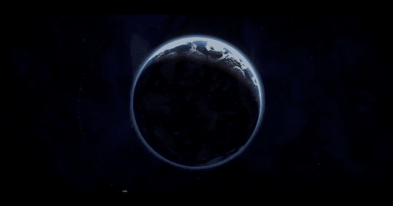

# AETHER

**A cinematic, real-time 3D journey through an invented universe, built entirely in the browser.**

[Live site](https://ahmadbhanvadiya-dot.github.io/aether/) · [Design notes](DESIGN.md) · [Product brief](PRODUCT.md)



You arrive in orbit around the ocean world Vael. From there you jump into the Aether system:
six worlds around the star Elys, each with its own sky, weather and life, that you can descend
to and walk. Scan what you find and a story starts to answer back: a signal from no point in
the system, an old survey that measured the way to a double star, and the people who left a
station in the dark between the galaxy's arms.

Every planet, star, sky and surface is generated on the GPU. There are no texture downloads,
and the whole journey, from title screen to galaxy to surface and back, runs as one
continuous scene rather than a set of pages.

---

## What's in it

- **Seven worlds in two star systems.** Aurelis, Nyx, Solara, Vesper, Thalassa and Orion
  circle Elys; Liris circles both suns of the binary Tessaly. Each world has three places
  to land, and its own terrain, weather, events and soundscape.
- **Two deep-space sites.** The Waystation, a derelict survey station, and the Keepers' Ring,
  read from orbit instead of landed on.
- **Discovery.** 74 discoveries on the worlds (signals, points of interest, and hidden finds
  that only appear when you look at the right place, or stay at it long enough) and 7 readings
  at the sites, each with its own record.
- **Seven expeditions.** A story told through what you find. Each expedition opens when the one
  before it ends, and some open new places on the galaxy map.
- **The Observatory.** A planisphere of the Aether system with every world's record, the
  archives of what you have found, a timeline of your discoveries, search and the sky's
  coming events.
- **A galaxy map.** Travel between the places you have reached. The map remembers your routes,
  dashes the ones you could fly, and keeps uncharted space under a fog that lifts as the
  story reveals more.
- **A real sky.** One simulation clock drives Kepler-consistent orbits, 11 moons, day and
  night, conjunctions, transits and eclipses, from orbit and from the ground. Speed it up,
  slow it down or pause it.
- **Cinematic motion.** A continuous camera from orbit through the atmosphere to the surface,
  flights between places, scans that lock on and land with a burst, and an opening where the
  signal tunes in and opens onto Vael.
- **Expedition Journal.** Every expedition, objective and story record, replayable.

Progress is saved in your browser.

## Controls

| | Mouse and keyboard | Touch |
|---|---|---|
| Look around, rotate | Drag (the title screen drifts with the cursor) | Drag |
| Zoom | Scroll | Pinch |
| Select a world, a place or a light to scan | Click | Tap |
| Step between worlds or places | `←` `→` | Panel arrows, or the place strip on a surface |
| Turn the view on a surface | `Shift` + arrows | Drag |
| Back (galaxy, orbit, close a panel) | `Esc` | Back button |
| Expedition Journal | `J` | Journal button |
| Observatory (at Elys) | `O` | Observatory button |
| Galaxy map (from a system overview) | `U` | Map button |
| Search the Observatory | `/` | Search field |
| Pause or play the sky clock | `T` | Clock controls |
| Slower or faster sky | `[` `]` | Clock controls |
| Sound on or off | `M` | Sound button |
| Hide the interface | `H` | Eye button |
| Start the journey from the title | `Enter` | Enter universe |

AETHER follows the system's **reduced motion** setting: movement is replaced by fades,
and decorative effects are turned off.

## Getting started

Requires [Node.js](https://nodejs.org/) 22 (the version the deploy uses) and npm.

```bash
npm install
npm run dev
```

Then open the URL Vite prints, usually <http://localhost:5173/>.

| Script | What it does |
|---|---|
| `npm run dev` | Development server with hot reload |
| `npm run build` | Type-check, then build to `dist/` |
| `npm run preview` | Serve the production build locally |
| `npm run lint` | Lint with oxlint |

### Review shortcuts

Add `?shot=` to the URL to jump straight to a view, skipping the opening:

| Shortcut | Opens |
|---|---|
| `?shot=orbit` | The title, in orbit around Vael |
| `?shot=galaxy` | The Aether system overview |
| `?shot=observatory` | The Observatory |
| `?shot=<world>` | A world in focus, for example `?shot=orion` |
| `?shot=<place>` | A surface, for example `?shot=aurelis-glass-shelf` |
| `?shot=tessaly`, `?shot=waystation`, `?shot=ring` | Story-locked places (development server only) |

Story-locked places and Liris's surfaces (`?shot=liris-twofold-shore`) only open this way on
the development server; on the live site they are reached through the expeditions.

## How it's built

**Stack:** React 19, TypeScript, Vite, Three.js through React Three Fiber, GSAP, Zustand and
Tailwind CSS. Fonts are Italiana and Manrope; icons are Lucide.

```
src/
  data/       worlds, places, discoveries, expeditions, star systems and sites, astronomy
  scene/      the 3D scene: Vael, the galaxy and its systems, surfaces, shaders, camera rigs
  systems/    places loaded on demand: Tessaly, the Waystation, the Keepers' Ring
  state/      stores and per-frame state: experience, exploration (saved), simulation, progress
  ui/         screens and overlays: title, HUD, panels, scanner, Observatory, map, journal
  audio/      the generated soundscapes and cues
  system/     loading, fault handling and health checks
```

A few principles hold throughout:

- **One continuous scene.** The camera rigs move between orbit, galaxy, atmosphere and
  surface inside a single canvas; nothing reloads.
- **Per-frame state outside React.** Animation reads and writes small mutable objects
  (`director`, `telemetry` and others) every frame, and overlays update the DOM directly,
  so motion never causes React re-renders.
- **Generated, not downloaded.** Terrain, skies, clouds, water, stars and the galaxy are
  shaders and procedural geometry. Places beyond Elys load as their own small chunks only
  when you travel there.
- **Progress is derived.** What you have discovered is the only story progress saved;
  expeditions, records, unlocks and the map's access are all computed from it.
- **One consistent sky.** The simulation is internally consistent: positions, seasons,
  eclipses and the Observatory's events come from the same orbital model.

[DESIGN.md](DESIGN.md) documents every phase in detail: the visual system, the choreography,
the astronomy, the expeditions and each world. [`docs/proposals`](docs/proposals) holds the
plans for phases before they were built.

## Deployment

Every push to `main` builds and deploys to GitHub Pages through
[`.github/workflows/deploy.yml`](.github/workflows/deploy.yml). The build uses a relative
base path, so the same output works at the site root or under a subpath.

## License

[MIT](LICENSE) © 2026 Ahmad.
